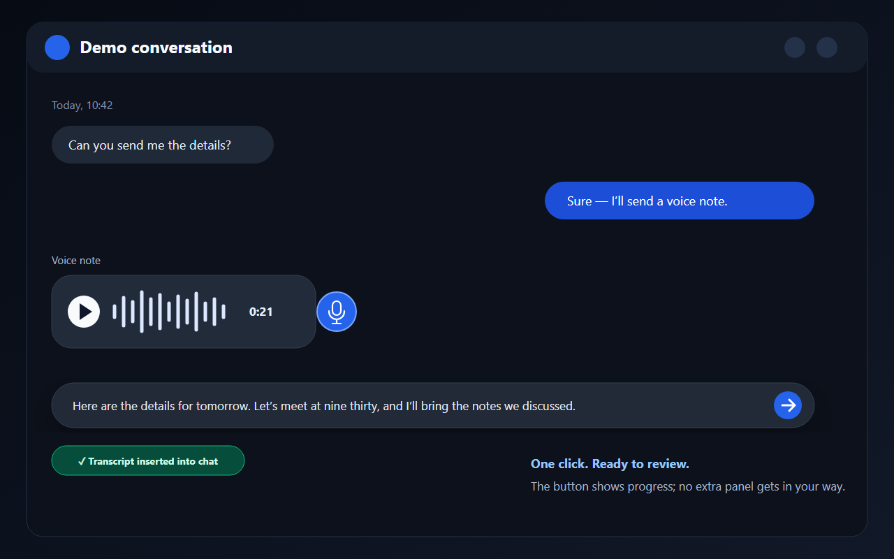
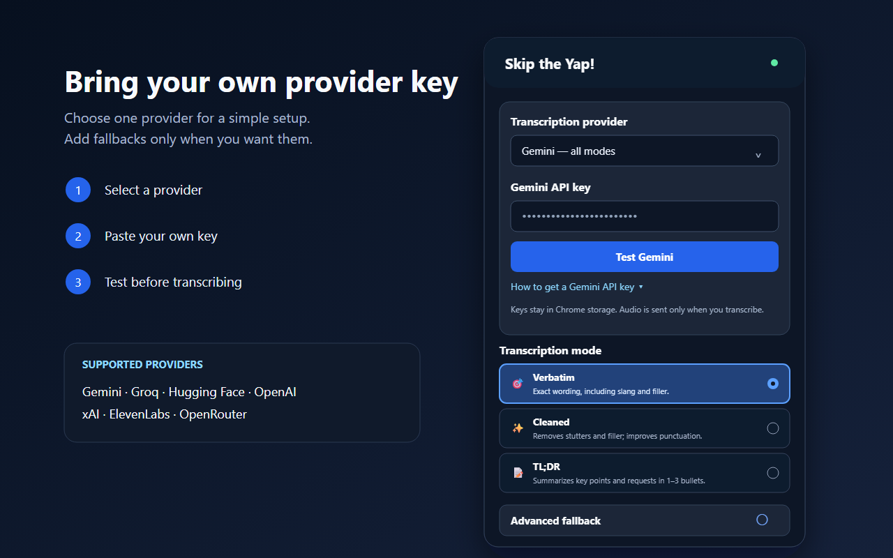
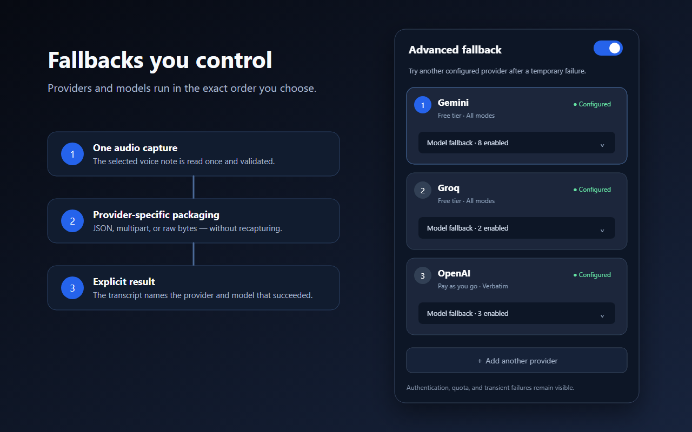
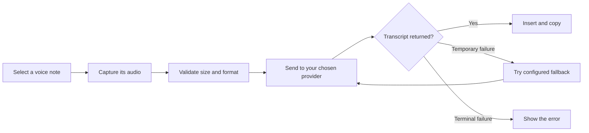

<div align="center">
  
  <h1>Skip the Yap!</h1>
  <h3>Let them yap. You get the point.</h3>
  <p>Turn Messenger and Instagram voice notes into readable transcripts or quick summaries with one click.</p>
  <p><strong>Transcribe · Clean up · Summarize</strong></p>
  <p>Privacy first · Your key, your provider · Open source</p>
</div>

<p align="center">
  
  &nbsp;&nbsp;
  
  &nbsp;&nbsp;
  
  &nbsp;&nbsp;
  
  &nbsp;&nbsp;
  
</p>



Skip the Yap! is an open-source Chrome extension for people who receive voice notes but would rather read them. It adds a small transcription control beside supported Messenger and Instagram Direct voice notes, captures only the message you select, and sends that audio directly to your chosen AI provider.

> **No collection. No tracking. No developer backend.** The extension developer cannot see your keys, audio, transcripts, or conversations. Provider processing remains subject to the provider you configure.

This project is independent and is not affiliated with or endorsed by Meta, Facebook, Instagram, Google, OpenAI, xAI, Groq, ElevenLabs, Hugging Face, or OpenRouter.

## What it does

- Transcribes the voice note you select without recording your microphone or browser tab.
- Supports Messenger, Facebook Messages, and Instagram Direct.
- Offers Verbatim, Cleaned, TL;DR, and custom-prompt workflows where supported.
- Inserts the result into the active chat composer and copies it to your clipboard by default.
- Supports ordered provider and model fallbacks for temporary failures.
- Stores provider keys and preferences only in local Chrome extension storage.

## Install locally

Requirements: Chrome or another Chromium browser with Manifest V3 support, plus Node.js 22 or newer.

```bash
git clone https://github.com/vasilistsavalias/skip-the-yap.git
cd skip-the-yap
npm install
npm run build
```

Then:

1. Open `chrome://extensions`.
2. Enable **Developer mode**.
3. Select **Load unpacked** and choose `dist/skip-the-yap`.
4. Open the extension, choose a provider, paste your own API key, and select **Test**.
5. Reload any existing Messenger or Instagram tabs.

See the [guided setup](docs/tutorials/getting-started.md) for provider-specific instructions and troubleshooting.

## Choose your provider



| Provider | Access model | Transcription | Cleaned / TL;DR | Request format |
|---|---|---:|---:|---|
| Gemini | Free tier and paid quotas | Yes | Yes | Base64 JSON |
| Groq | Free developer allowance and paid usage | Yes | Yes | Multipart audio, then text processing |
| Hugging Face | Limited inference credits and paid providers | Yes | No | Raw audio bytes |
| OpenAI | Pay as you go | Yes | No | Multipart audio |
| xAI | Pay as you go | Yes | No | Multipart audio |
| ElevenLabs | Limited credits and paid usage | Yes | No | Multipart audio |
| OpenRouter | Pay as you go | Yes | No | Multipart audio |

Availability, quotas, pricing, model names, and provider retention rules are controlled by each provider and can change. Read the [provider reference](docs/reference/providers.md) before enabling fallbacks.

## Fallbacks you control



The selected audio is captured and validated once. If a temporary provider or model failure occurs, the same payload can move through your configured fallback order without replaying or recapturing the message.

## How it works



See [Architecture](docs/explanation/architecture.md) for the capture flow, request formats, and trust boundaries.

## Development

```bash
npm install
npm run check
npm run package
```

| Command | Result |
|---|---|
| `npm test` | Runs behavior and security regression tests |
| `npm run lint` | Lints extension source, tools, and tests |
| `npm run build` | Produces `dist/skip-the-yap/` |
| `npm run package` | Produces a versioned Chrome Web Store ZIP in `dist/` |
| `npm run check` | Runs lint, tests, and a validated build |

Read [Development](docs/how-to/development.md) before changing capture selectors, provider requests, permissions, or storage contracts.

## Repository layout

```text
src/                 Manifest V3 extension source
tools/               deterministic build and ZIP packaging
tests/               Node and JSDOM behavior tests
docs/                user, architecture, maintainer, and research docs
assets/brand/         editable brand and social-preview sources
store-assets/         Chrome Web Store copy and synthetic screenshots
dist/                 generated release output; never committed
```

## Privacy and security

- No extension account, analytics, advertising, or transcript history.
- No API key ships with the extension.
- Selected audio goes over HTTPS directly to providers you configure.
- The extension never reads your clipboard; it can only copy a finished transcript when enabled.
- Advanced fallback may send the same selected audio to the next provider you configured after a retryable failure.

Read the [Privacy Policy](PRIVACY.md), [Security Policy](SECURITY.md), and [privacy and permissions reference](docs/reference/privacy-and-permissions.md).

## Documentation

- [Documentation hub](docs/index.md)
- [Getting started](docs/tutorials/getting-started.md)
- [Architecture](docs/explanation/architecture.md)
- [Provider reference](docs/reference/providers.md)
- [Privacy and permissions](docs/reference/privacy-and-permissions.md)
- [Development guide](docs/how-to/development.md)
- [Release runbook](docs/operations/releasing.md)
- [Research and official sources](docs/research/platform-and-provider-sources.md)

## Contributing

Bug reports and focused pull requests are welcome. Read [CONTRIBUTING.md](CONTRIBUTING.md) and never include real conversations, audio, screenshots, authenticated media URLs, or credentials in an issue.

## License

Released under the [MIT License](LICENSE). Provider names and service marks belong to their respective owners.
